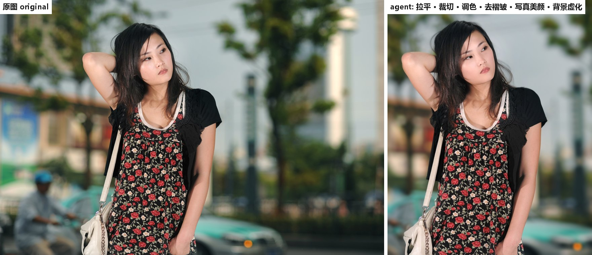
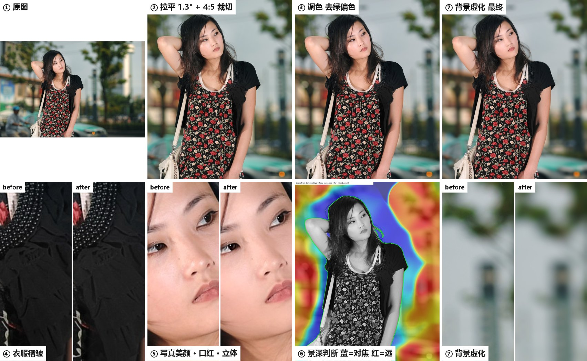
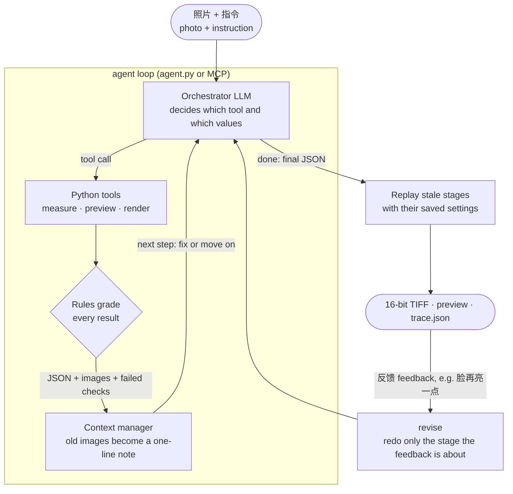
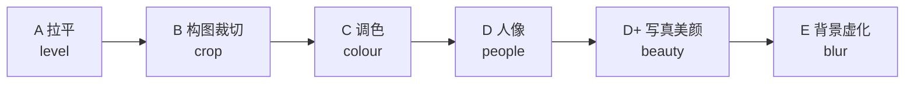

# AI agent Photoshop — a photo-retouching agent

**The model decides, the tools execute, the rules grade.**
模型做决策，工具执行，规则打分。

A multimodal LLM (any OpenAI-compatible endpoint with function calling and image input; developed
with Tencent Hunyuan `hy4-flash`) edits a photo the way a photographer would: it levels the horizon,
chooses a crop, corrects colour and tone, retouches people, and on request does a 写真 beauty retouch
and background blur. The model only makes decisions. Every measurement and pixel operation is done by
deterministic Python tools (OpenCV, rawpy, MediaPipe), and every result is checked by explicit rules.
You can run it with its own loop (`agent.py`) or from Claude Code, ChatGPT (Codex) or WorkBuddy over MCP.



Instruction: *"拉平、裁切、调色，然后写真精修：豆沙色口红、加一点立体，衣服褶皱去一下，最后背景虚化。"*
(level, crop, correct colour, then a 写真 retouch with 豆沙 lipstick and a little contour, smooth the
clothing wrinkles, and finally blur the background), followed by one revision: *"豆沙色口红要明显一点"*
(make the lipstick more visible).



| Step | What the agent decided |
|---|---|
| ① → ② | Rotated 1.34°: it trusted the lamp posts and building edges, not the car body the line detector called the "horizon". Then a 4:5 crop with the eyes on the upper third. |
| ③ | Tint +12 to remove a green cast. |
| ④ | `clothes_smooth` 55: creases on the black cardigan softened, the floral print and the beads untouched. |
| ⑤ | `beauty_retouch` at the 写真 level: clean skin with pores kept, contour 50, 豆沙 (rose) lipstick. Her face was already close to the target shape, so the shape edits stayed small. |
| ⑥ | `analyze_depth`: "mixed depth" (parts of the street are already softer, i.e. farther), suggested strength 45–75. |
| ⑦ | `apply_background_blur` at 45: far areas blurred more, no halo around her hair. |
| revise | "豆沙色口红要明显一点": only the beauty step was redone (lipstick 50); the blur was re-applied automatically. 2 steps, 25k tokens instead of a full re-edit. |

*Photo: "Asian young woman" by Lu Yu, [CC BY 2.0](https://creativecommons.org/licenses/by/2.0/), from
[Wikimedia Commons](https://commons.wikimedia.org/wiki/File:Asian_young_woman.jpg) /
[Flickr](https://www.flickr.com/photos/yulucs/4930631837/). Changes: leveled, cropped, colour-corrected,
retouched and background-blurred by this agent. The two images above stay under CC BY 2.0.*

## How it works

### The agent loop



1. **The model decides.** It sees the photo, the tool results and the images the tools make (overlays,
   contact sheets, before/after sheets) and chooses what to call next and with which values. When it
   cannot judge a number, it asks for a preview (`preview_variants`) instead of guessing.
2. **The tools execute.** All measurement and pixel work is deterministic Python. The agent pins every
   file path itself, so each tool always reads the right input (the latest result of the stage before
   it) and settings never stack.
3. **The rules grade.** Every result comes back with its checks (tilt, framing rules, clipping, skin
   colour, halo, texture, identity...). A failed check goes back to the model, which fixes it in the
   next step (usually at most 2–3 tries per stage).
4. **Context management.** Once the model has looked at an image, the next calls carry only a one-line
   note about it (`--keep-images`, default 1). That cut a 12-step run's input tokens by 21%.
5. **Revise.** Your feedback starts a short run from the saved state (`--revise`, or `resume_edit` over
   MCP): the model redoes only the stage the feedback is about, and every later stage built on it is
   re-applied with its saved settings.

### The stages



Each stage works on the file of the stage before it. A to D run on every photo. Style (C), beauty (D+)
and blur (E) only run when you ask for them. Redoing a stage marks the later stages as stale, and they
are re-applied before the run ends.

## Tools

19 tools for the model, grouped by stage. Over MCP there are 3 more (see below).

### A · Leveling (拉平)

| Tool | What it does | How | Checks |
|---|---|---|---|
| `estimate_tilt` | Measures how far the photo is rotated. Returns three independent candidates (`horizon_line`, `horizontal_lines`, `vertical_lines`) and an overlay of the lines it used. | Line segment detection; verticals get a perspective (keystone) fit so leaning buildings don't count as tilt. The model decides which lines are truly level or plumb. | — |
| `apply_rotation` | Rotates the full-resolution original by the total angle and returns `valid_rect`, the area without empty corners. | Always rotates the original, so rotations never stack. | at most 2 rotations |
| `check_level` | Measures the tilt left in the result. | Same line measurement on the rotated image, inside `valid_rect`. | pass ≤ 0.3°, or "inconclusive" when there are too few lines |

### B · Composition (构图裁切)

| Tool | What it does | How | Checks |
|---|---|---|---|
| `propose_crops` | Proposes and scores crops in several aspect ratios (1:1, 4:5, 3:2, 16:9…) and returns a contact sheet. | Classifies the scene (people / landscape / general) and scores classical framing rules: thirds, eyes on the upper third, headroom, lead room in the gaze direction, no cuts at joints (body pose), horizon on a third, prominent objects (saliency) kept whole. | each candidate lists its rule problems |
| `apply_crop` | Crops the full-resolution image. | Refused if the rect leaves the valid area. | composition rules on the result; at most 2 crops |

### C · Colour and tone (调色)

| Tool | What it does | How | Checks |
|---|---|---|---|
| `analyze_color` | Measures tone and colour: percentiles, clipping, colour cast with a suggested white balance, the main face's skin tone, blue sky, dominant colours. | Lab statistics on grey areas, skin and sky. | lists failed checks |
| `preview_variants` | Renders one slider at 2–6 values side by side, so the model chooses by eye. | Same render pipeline as the final. | — |
| `render_adjustments` | Fast preview of a full set of settings, with checks. | Parametric pipeline: white balance, exposure, highlights/shadows, curve, 8-colour HSL, grading, film LUTs. | clipping, skin hue, cast, exposure, blue sky stays blue |
| `apply_color` | Renders the final 16-bit image and saves the settings as JSON. | | same checks + face colour shift |
| `preview_looks` | Shows every look recipe on top of the base correction (only when a look is asked for). | Recipes include 8 Fuji film-emulation LUTs. | — |
| `match_reference` | 样片追色: matches the colour, exposure and curve of a sample photo you give. | Statistics matched with limits: a night photo stays a night photo, skin moves least. | face colour shift |
| `suggest_styles` | 风格记忆: when you ask for "a style" without naming one, judges which of the 11 library styles fits. | Measures the scene (day/night, people, sky, foliage, blossom, snow, city lights) and scores each style. | — |
| `apply_style` | Settings for a named library style (spring 春 … wedding 婚礼浅色), matched to its sample. | | face colour shift |

Every colour tool reports `face_shift`: how far the main face's skin moved, in white-balance units.
Over ±20, the scene keeps the style and the face is corrected locally in step D.

### D · People (人像)

| Tool | What it does | How | Checks |
|---|---|---|---|
| `detect_people` | Finds people: faces (478 landmarks), body pose, and masks for face skin, body skin, hair, clothes and the whole person. Returns an overlay. | MediaPipe face landmarker, pose and multiclass selfie segmentation; masks snapped to real edges with a guided filter. | — |
| `preview_retouch` / `apply_retouch` | Relights the whole person (`subject_light`), local edits by region (face, skin, hair, clothes, background), skin smoothing, light slimming, and `clothes_smooth` for clothing wrinkles (衣服褶皱). | Frequency separation keeps pores. Wrinkles are the middle band of lightness: removed, while fine fabric texture is kept and prints and seams are protected. | no halo, face not lit separately, skin texture kept, slimming subtle, background not warped, fabric texture and prints kept |

### D+ · Beauty retouch (写真美颜, only on request)

| Tool | What it does | How | Checks |
|---|---|---|---|
| `beauty_retouch` | One call does the whole face retouch: blemishes, dark circles, shine, skin smoothing and tone, face shape (slim, V-face, jaw, chin), eyes, nose, mouth, teeth, lipstick (口红: natural / 豆沙 rose / 橘 coral / 正红 red / 莓果 berry) and contour (立体). Levels: natural 自然 (never changes face shape), xiezhen 写真, wanghong 网红. | Measures each face and fills only the gap to a target face: big eyes get no enlarging, rich lips get little lipstick, a face already shaped by light gets little contour. A shade you name always shows. Then it renders, runs the guards and lowers only the sliders that broke one (up to 3 rounds). | same person (shift ≤ 6% of face width, eyes ×0.8–1.2, nose, mouth), pores kept, symmetry not worse, human proportions, straight background lines stay straight, lipstick stays on the lips, contour ≤ 0.2 EV, teeth not paper-white |

The model only chooses the level and what to avoid ("眼睛不要放大" → `avoid: ["eyes"]`). Design:
[docs/beauty_agent_design.md](docs/beauty_agent_design.md).

### E · Background blur (背景虚化, only on request)

| Tool | What it does | How | Checks |
|---|---|---|---|
| `analyze_depth` | 判断景深构造 before blurring: a verdict (`already_shallow` / `sharp_background` / `mixed_depth`), a suggested strength range and a depth map. | Depth from defocus: at every edge it measures how blurred it already is (re-blur ratio, Zhuo & Sim 2011). Areas softer than the subject are farther from the focal plane. The subject's own outline is excluded. | — |
| `apply_background_blur` | Blurs everything except the people, more where it is farther. | Lens-like disc blur at three radii, mixed per area by the depth map. The subject's colours are kept out of the blur (normalised convolution), and the photo's grain is put back on the blurred areas. | subject untouched, no halo, background softer |

When the background is as sharp as the subject, the tool can't tell "everything in focus" from "a wall
right behind her". The model judges that from the photo: a wall a step away gets little or no blur.

### MCP only

| Tool | What it does |
|---|---|
| `start_edit` | Starts an edit: creates the run folder and returns the full workflow and a preview of the photo. |
| `resume_edit` | Revises an earlier run after feedback: returns the previous decisions and the current result. |
| `finish_edit` | Re-applies stale stages, writes `trace.json` and returns the final file. |

Full explanations, written for learning: [English report](docs/REPORT_en.md) · [中文报告](docs/REPORT_zh.md).

## Setup

```powershell
python -m venv .venv
.\.venv\Scripts\python.exe -m pip install -r requirements.txt
.\.venv\Scripts\python.exe scripts\setup_models.py     # face / pose / segmentation models, ~25 MB
copy .env.example .env                                  # then put your API key in .env
```

## Use

```powershell
# full edit (no style: technical correction only)
.\.venv\Scripts\python.exe agent.py path\to\photo.NEF --instruction "Level, crop, correct colour, retouch people."
# with a style from the library, or a sample photo to match
.\.venv\Scripts\python.exe agent.py photo.NEF --instruction "胶片感 film style"
.\.venv\Scripts\python.exe agent.py photo.NEF --reference my_sample.jpg
# change an earlier edit: only the stages the feedback is about are redone
.\.venv\Scripts\python.exe agent.py --revise runs\photo_20261126_101500 --instruction "脸再亮一点，不要瘦脸"
```

**Revise (多轮修改)**: `--revise` loads the earlier run's state and decisions and shows the model the
current result. The model redoes only what the feedback is about (for example the beauty retouch), and
stages after the one it redid are re-applied with their previous settings, so a colour change never
silently drops the retouch. The result goes to a new folder `runs/<run>_rev1/`.

**Context management**: the model looks at every overlay and contact sheet once. After that, older
tool images are replaced in its context by a one-line note saying what they were (`--keep-images`,
default 1; 0 keeps everything). On the Hangzhou portrait this cut the input tokens of a 12-step run
from 237,828 to 187,839 (-21%), with the same decisions. Most of what is left is fixed: the system
prompt and the 17 tool descriptions (about 8.7k tokens) are sent again on every step. `trace.json`
records `prompt_tokens` per step.

Each run writes `runs/<photo>_<time>/` with every intermediate image and `trace.json`, which records
every model message and tool call. Reading the trace is the best way to see what the agent decided and why.

**Style library**: two openly licensed samples are included; add your own for the other styles, see
[samples/README.md](samples/README.md).

## Use it from Claude Code, ChatGPT (Codex) or WorkBuddy

`mcp_server.py` serves the same tools over MCP (Model Context Protocol). Your AI app's own model
then does the orchestrator's job (the job `hy4-flash` does in `agent.py`), so no Hunyuan API key is
needed. The tools, the checks and the run folder are the same, and the server always feeds each
tool the right intermediate file. The app's model must be able to see images: overlays, contact
sheets and before/after sheets come back as images.

The server has 22 tools: `start_edit`, `resume_edit` (revise an earlier run after feedback), the
agent's 19 tools, and `finish_edit`. `start_edit` returns
the full workflow, so any MCP client can follow it. Clients that support MCP prompts also get it as
the `retouch_workflow` prompt.

First install the requirements (they include the `mcp` package) and run the model setup, as in
[Setup](#setup). In the commands below, replace `C:\path\to\photo-retouch-agent` with your own folder.
On macOS/Linux, use `.venv/bin/python`.

### Claude Code

```powershell
cd C:\path\to\photo-retouch-agent
claude mcp add photo-retouch -- C:\path\to\photo-retouch-agent\.venv\Scripts\python.exe C:\path\to\photo-retouch-agent\mcp_server.py
```

Start `claude` in the project folder and check that `/mcp` lists `photo-retouch`. The repository
includes a skill (`.claude/skills/photo-retouch/SKILL.md`), so you can simply ask:

> 修一下 D:\photos\portrait.jpg：拉平、裁切、调色，然后做写真美颜

### ChatGPT desktop app / Codex CLI

The ChatGPT desktop app (Codex), the Codex CLI and the Codex IDE extension share one MCP
configuration:

```powershell
codex mcp add photo-retouch -- C:\path\to\photo-retouch-agent\.venv\Scripts\python.exe C:\path\to\photo-retouch-agent\mcp_server.py
```

You can also add it to `~/.codex/config.toml` yourself:

```toml
[mcp_servers.photo-retouch]
command = 'C:\path\to\photo-retouch-agent\.venv\Scripts\python.exe'
args = ['C:\path\to\photo-retouch-agent\mcp_server.py']
```

Then ask: *"Use the photo-retouch tools: start_edit on D:\photos\portrait.jpg and follow its workflow.
Level, crop, correct colour, and do a 写真 beauty retouch."*

ChatGPT on the web (chatgpt.com) cannot start local programs. It only connects to remote MCP servers
over HTTPS, in developer mode. That would mean putting this server on the internet, which these
instructions don't cover.

### WorkBuddy

WorkBuddy connects to MCP servers by URL. Start the server in HTTP mode and keep that window open:

```powershell
C:\path\to\photo-retouch-agent\.venv\Scripts\python.exe C:\path\to\photo-retouch-agent\mcp_server.py --http 8765
```

In WorkBuddy, open **Connections → Custom connections → Configure MCP** (this edits
`~/.workbuddy/mcp.json`), add the server, then **Save**:

```json
{
  "mcpServers": {
    "photo-retouch": { "url": "http://127.0.0.1:8765/mcp" }
  }
}
```

Turn it on under **My MCP**, then ask as above. The server listens only on your own computer
(127.0.0.1).

## Evaluate and test

```powershell
.\.venv\Scripts\python.exe -m pytest -q                                   # tool tests (no API calls)
.\.venv\Scripts\python.exe -m evals.harness --agent cv                    # CV-only baseline
.\.venv\Scripts\python.exe -m evals.harness --agent hy --folder photos\   # the LLM agent
```

The harness grades leveling against your own Lightroom edits when you have them (RAW files in
`data/raw`, your exported JPEGs in `data/exports`): it recovers your rotation with SIFT and passes
under 0.5° error. It also grades the crop, colour and retouch with the same rules as above.

## Project layout

| Path | What |
|---|---|
| `agent.py` | system prompt, tool-calling loop, path pinning, final JSON |
| `mcp_server.py` | the same tools as an MCP server for Claude Code, Codex / ChatGPT, WorkBuddy |
| `.claude/skills/photo-retouch/` | Claude Code skill: when and how to use the tools |
| `agent_tools/` | the tools: `horizon`, `composition`, `color`, `styles`, `people`, `face`, `beauty`, `depth`, `registry` |
| `evals/` | evaluation harness and ground truth from Lightroom exports |
| `tests/` | pytest tests |
| `docs/` | composition rules, reports, face-panel study, beauty design |
| `luts/`, `samples/` | film LUTs and style samples, with their licences |

## Licence and credits

Code: MIT (see [LICENSE](LICENSE); third-party content in [NOTICE.md](NOTICE.md)). Film LUTs: Pat David, CC BY-SA 4.0.
Example photo: Lu Yu, CC BY 2.0 (edited). Style samples: see
[samples/SOURCES.md](samples/SOURCES.md). Models: OpenCV Zoo YuNet (MIT) and Google MediaPipe (Apache 2.0),
downloaded by the setup script.
