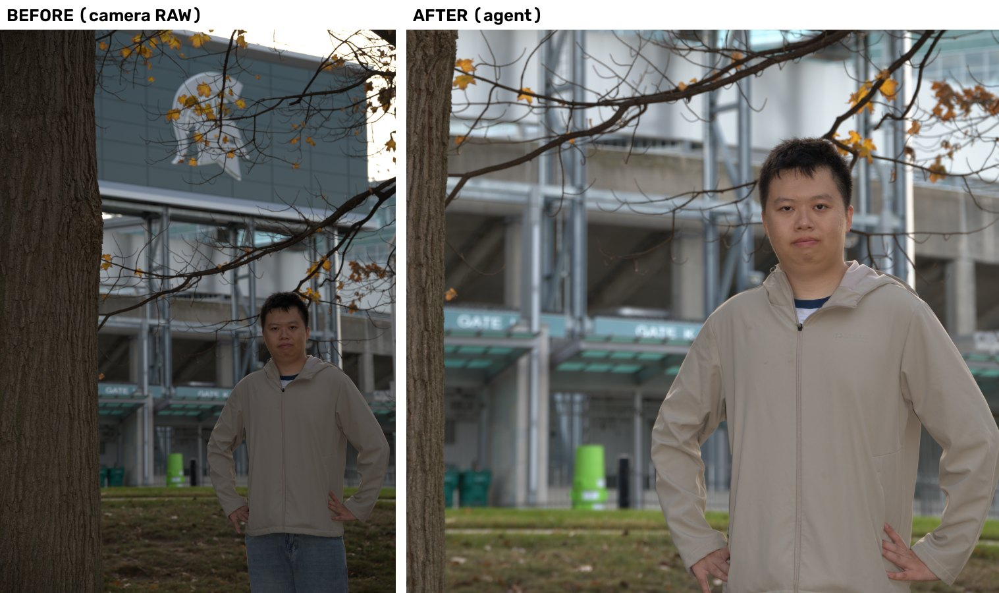
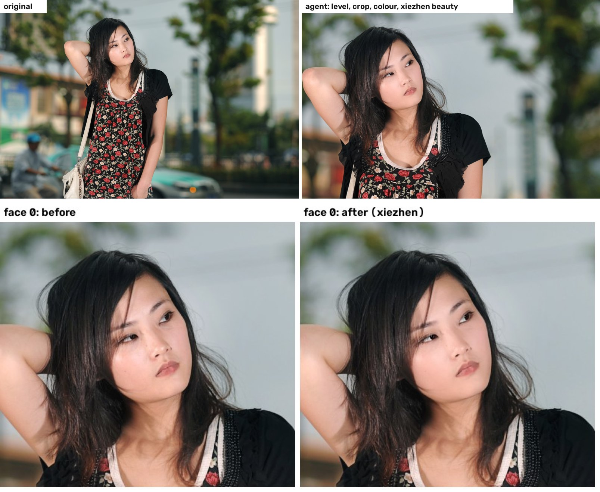

# AI agent Photoshop — a photo-retouching agent

**The model decides, the tools execute, the rules grade.**
模型做决策，工具执行，规则打分。

A multimodal LLM (any OpenAI-compatible endpoint with function calling and image input; developed
with Tencent Hunyuan `hy4-flash`) edits a photo the way a photographer would: it levels the horizon,
chooses a crop, corrects colour and tone, and retouches people. The model only makes decisions. Every
measurement and pixel operation is done by deterministic Python tools (OpenCV, rawpy, MediaPipe), and
every result is checked by explicit rules.



*Example photo by the project author, used with permission (not covered by the MIT licence).*

## How it works

```
Photo + instruction (+ optional sample photo / style)
        │
        ▼
Orchestrator LLM  ──tool calls──►  A  Leveling      estimate_tilt · apply_rotation · check_level
(agent.py loop)   ◄─JSON+images──  B  Crop          propose_crops · apply_crop
        ▲                          C  Colour        analyze_color · render_adjustments · apply_color
        │                                           match_reference · suggest_styles · apply_style
        │                          D  People        detect_people · preview_retouch · apply_retouch
        │                                           beauty_retouch (美颜, only on request)
        │                                │
        └──── issues (2–3 retries) ◄── checks: tilt, composition rules, clipping, skin, sky,
                                         face colour shift, halo, texture, warping
                                                 │ pass
                                                 ▼
                                  16-bit TIFF + JPEG preview + params JSON
```

- **A · Leveling**: line segments with a perspective (keystone) fit; the model chooses which lines
  are truly level or plumb.
- **B · Composition**: crops scored on classical rules: thirds, eye line, headroom, lead room, no cuts
  at joints, horizon placement, and prominent objects kept whole.
- **C · Colour**: a parametric pipeline (white balance, exposure, highlights/shadows, curve, 8-colour
  HSL, film LUTs, grading). Sample matching (样片追色) and a style library (风格记忆) are used only
  when the user asks for a style. The skin colour of faces is limited to ±20 white-balance units.
- **D · People**: MediaPipe masks for relighting the whole person, natural skin smoothing, light
  slimming, and skin-colour correction. Checks catch halos and faces that are lit separately.
  On request, `beauty_retouch` does a 像素蛋糕写真 / 网红脸 style face retouch (see below).

## Beauty retouch (美颜: 写真 / 网红脸)



*"Asian young woman" by Lu Yu, [CC BY 2.0](https://creativecommons.org/licenses/by/2.0/), from
[Wikimedia Commons](https://commons.wikimedia.org/wiki/File:Asian_young_woman.jpg) /
[Flickr](https://www.flickr.com/photos/yulucs/4930631837/). Changes: leveled, cropped, colour-corrected
and face-retouched by this agent at the 写真 (xiezhen) level.*

Instruction: *"Level, crop and correct this portrait, then do a 像素蛋糕写真 beauty retouch (写真精修)."*
The model rotated the photo 1.34° (it trusted the vertical lines, not the car body), chose a medium
close-up, removed a green cast and called `beauty_retouch` at the 写真 level.

`beauty_retouch` is one deterministic tool. The model only picks the level (natural 自然 / xiezhen 写真 /
wanghong 网红) and what to avoid ("眼睛不要放大"). Python measures each face and fills only the gap to
a target face: this face was already close to the target, so it got only small shape edits (eye_size 13 of 40, nose_size 11 of 35). Guards check
that she is still the same person, pores are kept, the face stays symmetric with human proportions, and
straight background lines stay straight; a failed guard lowers only the slider that caused it. Design:
[docs/beauty_agent_design.md](docs/beauty_agent_design.md).

Full explanations, written for learning: [English report](docs/REPORT_en.md) · [中文报告](docs/REPORT_zh.md).

## Setup

```powershell
python -m venv .venv
.\.venv\Scripts\python.exe -m pip install -r requirements.txt
.\.venv\Scripts\python.exe scripts\setup_models.py     # face / pose / segmentation models, ~25 MB
copy .env.example .env                                  # then put your API key in .env
```

## Use

```powershell
# full edit (no style: technical correction only)
.\.venv\Scripts\python.exe agent.py path\to\photo.NEF --instruction "Level, crop, correct colour, retouch people."
# with a style from the library, or a sample photo to match
.\.venv\Scripts\python.exe agent.py photo.NEF --instruction "胶片感 film style"
.\.venv\Scripts\python.exe agent.py photo.NEF --reference my_sample.jpg
```

Each run writes `runs/<photo>_<time>/` with every intermediate image and `trace.json`, which records
every model message and tool call. Reading the trace is the best way to see what the agent decided and why.

**Style library**: two openly licensed samples are included; add your own for the other styles, see
[samples/README.md](samples/README.md).

## Evaluate and test

```powershell
.\.venv\Scripts\python.exe -m pytest -q                                   # tool tests (no API calls)
.\.venv\Scripts\python.exe -m evals.harness --agent cv                    # CV-only baseline
.\.venv\Scripts\python.exe -m evals.harness --agent hy --folder photos\   # the LLM agent
```

The harness grades leveling against your own Lightroom edits when you have them (RAW files in
`data/raw`, your exported JPEGs in `data/exports`): it recovers your rotation with SIFT and passes
under 0.5° error. It also grades the crop, colour and retouch with the same rules as above.

## Project layout

| Path | What |
|---|---|
| `agent.py` | system prompt, tool-calling loop, path pinning, final JSON |
| `agent_tools/` | the tools: `horizon`, `composition`, `color`, `styles`, `people`, `face`, `beauty`, `registry` |
| `evals/` | evaluation harness and ground truth from Lightroom exports |
| `tests/` | pytest tests |
| `docs/` | composition rules, reports, PixCake face-panel study |
| `luts/`, `samples/` | film LUTs and style samples, with their licences |

## Licence and credits

Code: MIT (see [LICENSE](LICENSE); third-party content in [NOTICE.md](NOTICE.md)). Film LUTs: Pat David, CC BY-SA 4.0.
Beauty example photo: Lu Yu, CC BY 2.0 (edited). Style samples: see
[samples/SOURCES.md](samples/SOURCES.md). Models: OpenCV Zoo YuNet (MIT) and Google MediaPipe (Apache 2.0),
downloaded by the setup script.
