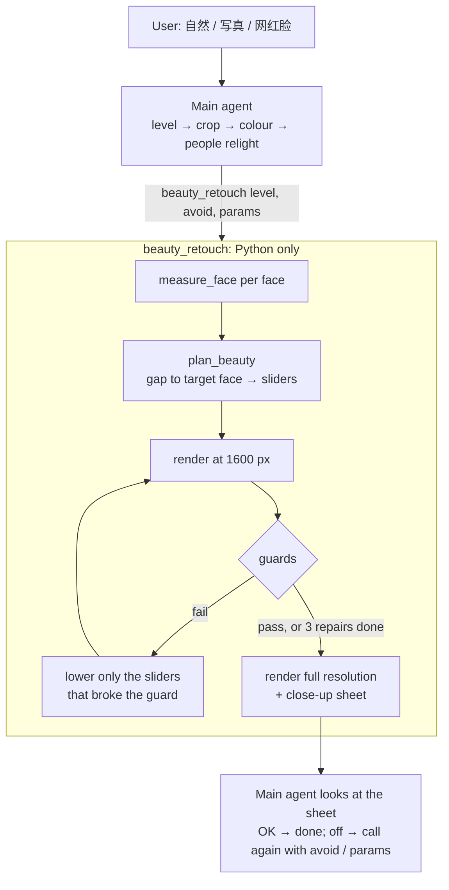

# 网红脸 / 写真 beauty retouch: design

Status (2026-11-23): step 1–2 built. `beauty_retouch` is a tool of the main agent
(`agent_tools/beauty.py`, tests in `tests/test_beauty.py`). Makeup, contour, double chin and the
写真 colour styles are not built yet (section 8).

## 1. What the look is made of

A 写真 / 网红 portrait is not one effect. It is six layers, and each layer needs a
different kind of tool:

| layer | what people notice | kind of tool |
|---|---|---|
| 1. clean skin | no spots, no dark circles, even tone, pores still visible | pixel edits inside skin masks |
| 2. luminous skin | 透亮, a little whiter and pinker, soft shadows | local colour/tone on skin |
| 3. face shape | V-face, small face, larger eyes, smaller nose, short chin | landmark-driven warps (liquify) |
| 4. features | bright eyes, clear iris, white-but-not-paper teeth, lip colour, blush | small region edits |
| 5. 立体 | highlight on nose bridge / forehead, soft contour under cheekbones | dodge & burn on landmark regions |
| 6. 写真 colour | bright, low contrast, airy (日系通透 / 奶油 / 冷白) | global grade, with the face protected |

## 2. Building blocks

| module | what it gives | layer |
|---|---|---|
| `face.py` | `measure_face`, `render_faces` with `acne_spots, dark_circles, eye_bags, oil_shine, nasolabial, smoothing, texture_keep, tone_unify, luminous, whitening, rosy` | 1, 2 |
| `face.py` | warps `face_slim, small_face, v_face, jaw, chin_length, cheekbone, eye_size, nose_size, nose_wings, mouth_size` (gains calibrated against a professionally retouched export of a test photo) | 3 |
| `face.py` | `eye_brighten, iris, eye_whites, teeth_whiten` | 4 |
| `face.py` | `face_checks`: identity (shift ≤ 6% face width, eyes ×0.8–1.2 area, nose 0.85–1.1, mouth 0.88–1.1), teeth L* ≤ 92, no halo, texture kept, background not warped | guards |
| `people.py` | masks, `subject_light` relight, `body_slim` | light, body |
| `color.py` / `styles.py` | styles, `face_shift` limit ±20 temp/tint | 6 |

## 3. Architecture: one tool, not a sub-agent

The decisions that matter are measurable, so the LLM gets one tool and only chooses the level and
what to avoid. Everything else is deterministic Python.

Why not a sub-agent (for now):

- **The decisions are measurable.** `plan_beauty` picks the sliders and the guards stop
  over-editing; an LLM inside would mostly repeat that, less reliably (hy4-flash is weak at
  "eye_size 35 vs 45" on a close-up).
- **One loop is easier to debug.** With two loops you can't tell whether the orchestrator asked
  badly or the sub-agent tuned badly.
- **The orchestrator keeps the evidence.** It sees the sheet, the sliders and the checks, the same
  pattern as the crop and colour tools.
- **Cheap to upgrade.** If evals later show the fixed plan misjudges faces only vision can fix, the
  same tool can be wrapped in a sub-agent without changing the tool.

How it sits in the main agent (`agent.py`, step 15b):

- Only when the user asks for 美颜 / 写真 / 网红脸. Words → level: 自然 → natural, 写真 / 精修 → xiezhen,
  网红 → wanghong. "眼睛不要放大" → `avoid: ["eyes"]`.
- Input is the people-retouch result (relight); the people retouch then runs WITHOUT a preset, so
  skin is not smoothed twice.
- Every call starts from the same input, so a second call replaces the first instead of stacking.
- At most 2 calls.

### Order inside the render (it matters)

1. Blemishes, dark circles, eye bags, shine and folds on the original geometry (masks match pixels).
2. Smoothing with texture kept, then tone unify, rosy.
3. Eyes and teeth.
4. Luminous / whitening on ALL skin (face and body together, so the face isn't lit separately).
5. All shape warps last, as one displacement field: warping once avoids resampling blur.

Group photos: each face gets its own plan from its own measurements; all-skin brightening runs
once with the strongest planned value.

## 4. plan_beauty: from measurements to sliders

Each level sets the MOST a slider may reach. The face's measurements decide how much of it is used:

| sliders | measured | full use when |
|---|---|---|
| eye_size | eye width / face width | ≥ 0.03 below target 0.205 (0 if already there; halved if eyes are half closed) |
| nose_size, nose_wings | nose width / face width | ≥ 0.04 above target 0.24 |
| face_slim, jaw, v_face | jaw / cheekbone width | ≥ 0.12 above target 0.70 |
| small_face | jaw | half by level, half by jaw |
| chin_length | face height / width | ≥ 0.15 below target 1.20 |
| mouth_size | mouth width / face width | ≥ 0.05 above target 0.33 |
| dark_circles | cheek L* − under-eye L* | 0 below 3, full at 8 |
| oil_shine | % shiny face skin | 0 below 0.5%, full at 3.5% |
| teeth_whiten | teeth visible? | 0 if not visible |

Protection: a turned face gets half the shape edits; a face under 6% of the frame height gets no
shape or eye-detail edits. Every slider comes back with a one-line reason (`why`).

Level maxima:

| param | natural | xiezhen (a typical 写真 one-click preset) | wanghong |
|---|---|---|---|
| acne_spots | 80 | 100 | 100 |
| smoothing / texture_keep | 35 / 60 | 70 / 45 | 75 / 40 |
| luminous / whitening / rosy | 10 / 0 / 0 | 20 / 10 / 0 | 30 / 20 / 20 |
| face_slim / jaw / v_face / small_face | 0 | 20 / 40 / 0 / 20 | 35 / 45 / 30 / 30 |
| eye_size | 0 | 40 | 55 |
| nose_size / nose_wings | 0 | 35 / 30 | 45 / 40 |
| mouth_size / chin_length | 0 | 30 / 0 | 30 / 15 |
| eye_brighten / iris / eye_whites | 25 / 0 / 20 | 40 / 70 / 30 | 50 / 80 / 35 |

## 5. Guards and repair

From `face.py`: identity shift ≤ 6%, eyes/nose/mouth bands, teeth L* ≤ 92, no halo, texture kept,
face not lit separately, background not warped.

New in `beauty.py`:

| rule | measure | repair if it fails |
|---|---|---|
| skin not plastic (pores kept) | face-skin fine detail after/before ≥ 0.45 | smoothing ×0.7 |
| symmetry not worse | left/right landmark asymmetry after ≤ before + 0.02 | shape ×0.8 |
| proportions plausible | edited eye/face ≤ 0.235, nose/face ≥ 0.20, jaw/cheek ≥ 0.62, height/width ≤ 1.35 | shape ×0.75 |
| background lines stay straight | for each LSD straight line in the background, the bow the warp puts in it ≤ 1 px at 1600 px | shape ×0.7 |

Lesson from building it: the first version of the straight-line guard measured the shear of the warp
field. It failed even for invisible sub-pixel warps (a 0.6 px shift fading over 25 px is "shear 0.02").
Measuring the actual bow of real detected lines fixed it. A guard has to measure what a viewer would
see.

Repair runs up to 3 rounds; existing guards repair too (eyes → eye_size ×0.7, nose → nose sliders,
teeth → teeth_whiten, halo / lit separately → luminous & whitening, identity / background → shape).

## 6. Results

A private test portrait (one face, 11% of the frame high); every guard passed with no repair:

| level | eye_size | nose_size | face_slim | max shift | eye area | time |
|---|---|---|---|---|---|---|
| natural | 0 | 0 | 0 | 0 | ×1.00 | 35 s |
| xiezhen | 28.7 | 35 | 11.7 | 0.6% | ×1.06 | 33 s |
| wanghong | 39.4 | 45 | 20.4 | 1.7% | ×1.06 | 33 s |

## 7. Not built yet

| tool | what it does | how |
|---|---|---|
| makeup: `lip_tint`, `blush` | 网红 lip and cheek colour | lip polygon from landmarks, a/b shift at low strength keeping texture; blush = soft ellipse below cheekbones |
| contour: `highlight`, `shadow` (立体) | soft dodge & burn | low-frequency luminance only: nose bridge, forehead, chin up; under cheekbones, jaw edge down; ≤ 0.15 EV |
| `double_chin` | 祛双下巴 (typical 写真 presets use about 70) | upward warp of the submental band + lifting its shadow, only when chin and neck are visible |
| `long_legs` | 长腿 | vertical stretch below the hips ≤ 5%, only with no strong straight lines there |
| 写真 colour styles | `xiezhen_airy` 日系通透, `xiezhen_cream` 奶油, `xiezhen_coolwhite` 冷白 | new library styles; need your sample photos |

Out of scope: stray hairs, tattoos, double eyelids and teeth straightening need generative inpainting.
It invents pixels, which rules can't check.

## 8. Build order

1. ✅ `beauty_retouch` tool + `plan_beauty` + guards + repair, wired into the agent (step 15b).
2. ✅ Tests: planner, levels, protection, line bend, validation, real photo.
3. `makeup` + `contour` (new params in `face.render_faces`, planned by level).
4. 写真 colour styles (needs samples).
5. `double_chin`, `long_legs`.
6. Calibrate the targets against more professionally retouched 写真 exports (the calibration script in `evals/`).
